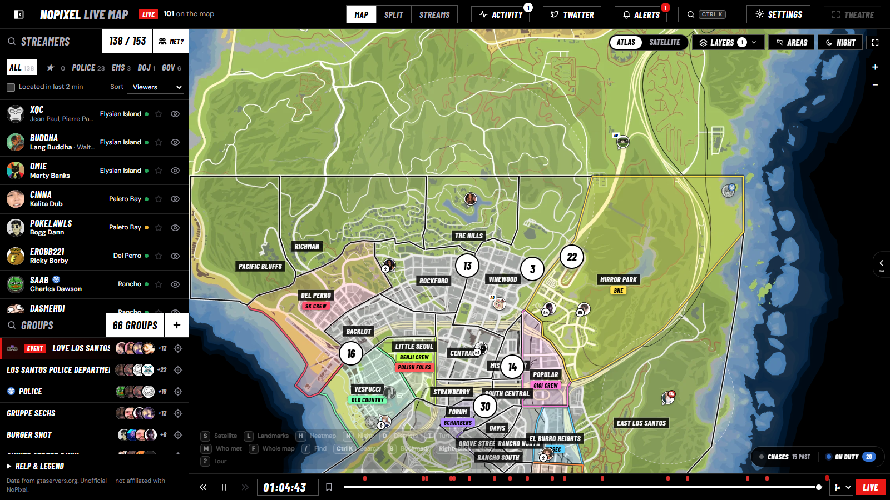
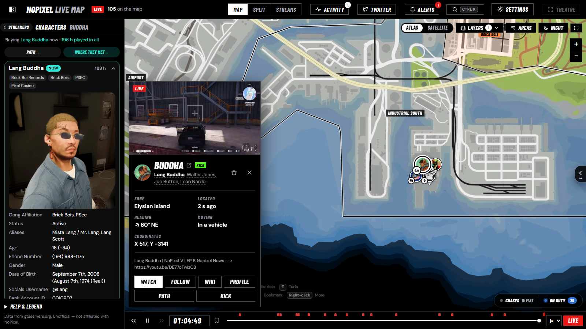
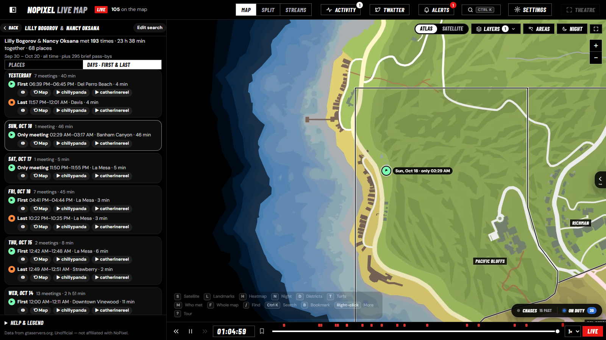
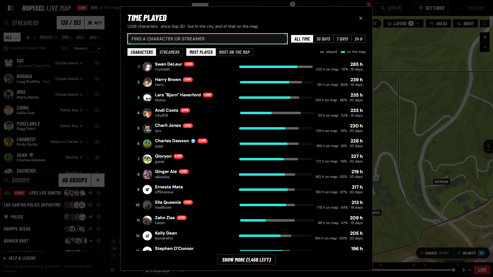
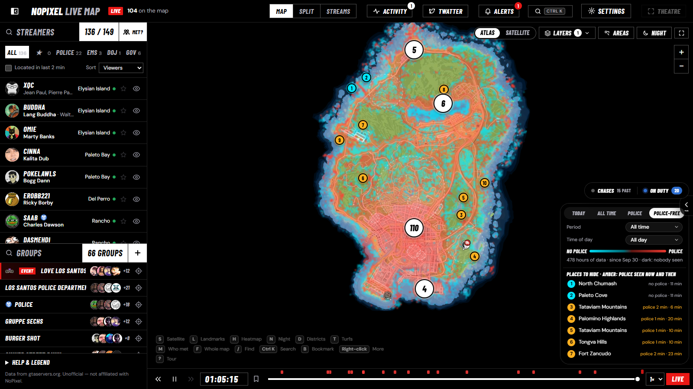
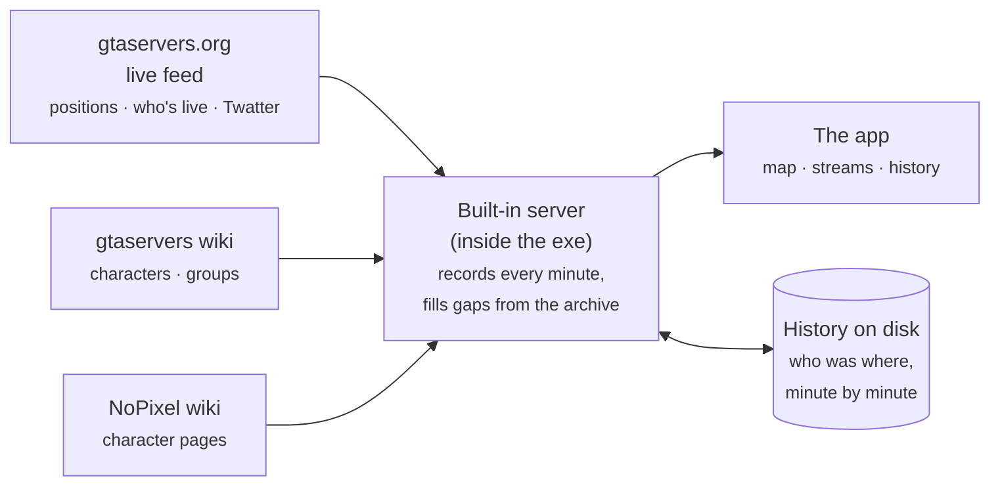

# 🗺️ NoPixel Live Map

**Every NoPixel streamer who's live, where they are in Los Santos right now, with their stream one click away, and weeks of city history behind it.**

[Features](#-features) · [Download](#-get-it) · [Shortcuts](#%EF%B8%8F-keyboard-shortcuts) · [How it works](#-how-it-works) · [FAQ](#-faq) · [Credits](#-credits)

---

## ✨ What it is

A Windows desktop app built on top of the public live feed behind [gtaservers.org/nopixel](https://gtaservers.org/nopixel). That feed reads every NoPixel stream's minimap a few times a minute and turns it into a position.

This app shows those positions live. It also **records everything it sees**, so you can look back:

- where people went
- who met whom
- where the police patrol, and where they never do
- how long everyone has played

Everything runs **on your own PC**. There are no accounts and no servers of ours; your settings and the history stay on your machine.

---

## 🚀 Features

<table>
<tr>
<td width="50%" valign="top">

### 🧍 Characters & the NoPixel wiki
Click anyone on the map and the whole sidebar becomes **their characters**. The one they're playing now opens with its **NoPixel wiki card**: picture, job and rank, aliases, relatives and story. If there's no wiki page yet, it says so.

Each character shows its **hours played**, with **Path** and **Where they met** one click away.

</td>
<td width="50%"></td>
</tr>
<tr>
<td width="50%"></td>
<td width="50%" valign="top">

### 🤝 Where did they meet?
Pick two characters (or streamers) and get **every place they were together** (within ~100 m), ranked by time together.

- **Places view:** numbered pins on the map.
- **Days view:** each day's **first ▶ and last ■ meeting**.
- Every meeting has **⟲ rewind the map to then**, plus both streamers' **VODs at that exact moment**.

Open it with <kbd>M</kbd>, the **Met?** button, or from any profile.

</td>
</tr>
<tr>
<td width="50%" valign="top">

### ⏱️ Time played
A leaderboard of **every character's hours**: all time, the last 30 days, 7 days or 24 hours. It shows how much of that time they were **on the map**, and can group by character or by streamer.

It counts time live *in the city* (other games don't count), and was checked against real VOD lengths.

</td>
<td width="50%"></td>
</tr>
<tr>
<td width="50%"></td>
<td width="50%" valign="top">

### 🔥 Heatmaps & hiding spots
- Where people go: **today, all time, any date range, any time of day**.
- Where the **police patrol**.
- **Police-free** areas, with a ranked list of **hiding spots** people can reach on foot and police never (or rarely) visit.

</td>
</tr>
</table>

### And much more

| | |
|---|---|
| 🗺️ **Live map** | Atlas or **satellite** map, night mode, **district** names, **2,300 landmarks** with in-game and real photos, street names. Crowds group into numbered circles when zoomed out. |
| 🏴 **Turfs** | Gang turfs in the colour of the gang holding them, with the gang under each name. **Edit who holds what on the fly**: right-click a turf name. |
| 📺 **Multi-stream** | Watch many Twitch & Kick streams beside the map, side by side or on a stage. Includes theatre mode, per-stream volume (scroll), hover-for-sound, and **middle-click to close**. |
| 💬 **Chat** | Twitch & Kick chat with **BTTV and 7TV emotes**, styled to match the app. |
| 🐦 **Twatter** | The city's social feed, live. New posts **pop up on the poster's marker**. **Where posted** shows where they were when they posted it. |
| 🚓 **Police & chases** | **Chases are detected from movement**, including "possible chases" when only the cops are streaming. Follow one live or **replay** it. The **On duty** board lists police by area. |
| 🧭 **Paths** | Where someone went **since going live, or on any day**. Point at the path for the time, place and speed, plus the **VOD at that moment**. |
| 📍 **Who's been here** | Draw any shape: everyone who's ever been inside it, with exact days, times and VOD links. |
| 🔔 **Areas & alerts** | Draw zones and get alerts when someone enters, leaves or stays. Also alerts when favourites go live. The **Activity** feed shows police lights, downed players, crowds and events. |
| ⏪ **Rewind** | Scrub the whole city back to any moment in the recorded history; bookmarks included. |
| 🔎 **Search everything** | <kbd>Ctrl</kbd>+<kbd>K</kbd>: streamers, characters, groups, areas and actions. |
| 🧑‍🤝‍🧑 **Groups** | The wiki's gangs, departments and businesses, plus your own groups. |
| 🎓 **Tour** | A one-minute guided tour on first start (<kbd>?</kbd> to replay). Map shortcuts are shown faintly in the corner. |

---

## 📦 Get it

1. Download **`NoPixelMapSetup.exe`** from the [**Releases**](../../releases) page.
2. Run it and click **Install**. It installs just for you (no admin needed), adds Start menu and desktop shortcuts, and lists the app in **Settings → Apps** for uninstalling.
   > Windows SmartScreen may warn about an unknown publisher (the installer isn't code-signed). Click **More info → Run anyway**.
3. **Everything's included:** the app brings its own Node.js and its own Python with numpy and Pillow, so every feature works out of the box. Nothing is installed system-wide.
4. **First start:** the app builds its history from the feed's archive, back to **Sep 30, 2026**. This takes about **20–30 minutes**; a small progress ring in the bottom-right shows how far it is. The live map works right away.

Requires **Windows 10 or 11** with the **Microsoft Edge WebView2 Runtime**, which is already on most PCs. If it's missing, get the [Evergreen installer](https://developer.microsoft.com/microsoft-edge/webview2/).

<b>Where does it keep its data?</b>

- The app: `%LOCALAPPDATA%\Programs\NoPixelMap\` (or wherever you chose in the installer)
- Its unpacked files (server, Node.js, Python): `%LOCALAPPDATA%\NoPixelMap\app-<version>\`, replaced on updates
- Your data: `%LOCALAPPDATA%\NoPixelMap\data\`: settings, the window position, a log, and `cache\` with the recorded history and cached map pictures (~200 MB after a few weeks)

To start completely fresh, close the app and delete `data\cache\`.

**Updating:** run the newer `NoPixelMapSetup.exe`; it shows **Update**. Your settings, areas, favourites and history are kept.

**Uninstalling:** Settings → Apps → NoPixel Live Map → Uninstall. You choose whether to keep your settings and the recorded history.

---

## ⌨️ Keyboard shortcuts

| Key | Does |
|---|---|
| <kbd>/</kbd> | Find a streamer or character |
| <kbd>Ctrl</kbd>+<kbd>K</kbd> | Search everything (streamers, characters, groups, areas, actions) |
| <kbd>M</kbd> | Where did two characters meet? |
| <kbd>H</kbd> | Heatmap |
| <kbd>T</kbd> | Turfs |
| <kbd>D</kbd> | District names |
| <kbd>L</kbd> | Landmarks |
| <kbd>S</kbd> | Satellite map |
| <kbd>N</kbd> | Night map |
| <kbd>F</kbd> | Whole map |
| <kbd>B</kbd> | Bookmark this moment |
| <kbd>Shift</kbd>+<kbd>T</kbd> | Theatre mode |
| <kbd>,</kbd> | Settings |
| <kbd>?</kbd> | The tour |
| <kbd>Esc</kbd> | Close / back |
| **Right-click** | More options for the spot / marker / stream under the cursor |
| **Middle-click** a stream | Close it |
| **Scroll** over a stream | Its volume |

---

## 🧠 How it works

- **Live:** the app's built-in server keeps a connection to the gtaservers feed and passes positions, the live roster, events and Twatter posts on to the page.
- **History:** every minute is boiled down to *who was in which 50 m square, and who was live as which character*, kept per hour as bit sets. That makes heatmaps, "who's been here", "where they met" and time played fast (a few milliseconds) over weeks of data.
- **Complete, even with the app closed:** history is filled in from the feed's own archive, back to its start (Sep 30). Minutes missed while the app was closed are fetched automatically later.
- **Characters** come from the stream title (nicknames like "DHead", Jr/Sr, quoted names), the gtaservers wiki roster, and what's been recorded before.

---

## ❓ FAQ

<b>"Played" vs "on the map": what's the difference?</b>

**Played** is the time someone was live as that character while in the city. **On the map** is the part of that time with a readable minimap, so an exact position. Menus, phone screens, interiors, cutscenes, the MDT, or a stream layout covering the minimap all cost "on the map" time.

Most streamers sit at 75–90% on the map. Features that need a place (heatmaps, who's been here, where they met, paths) use the on-the-map time; the leaderboard shows both.

<b>Why is a marker grey?</b>

The streamer's live, but their minimap couldn't be read for a while (menu, loading, queue, hidden HUD). The marker stays where they were last seen. Point at it: the app looks at their stream picture and tells you why.

<b>Why does a streamer show "No character listed"?</b>

Their stream title doesn't name a character, the gtaservers roster doesn't list any, and no earlier recording has one either. As soon as one of those appears, the character shows up.

<b>Does the app need to run all the time to keep the history?</b>

No. Anything missed while it was closed is filled in from the feed's archive the next time it runs. The pill in the bottom-right shows "Filling gaps" while it does that.

<b>Does it send my data anywhere?</b>

No. It only *reads* public data: the gtaservers feed, the wikis, Twitch/Kick for streams, chat and VODs, and BTTV/7TV for emotes. Your settings, areas, favourites and turf edits stay on your PC.

---

## 🙏 Credits

- **[gtaservers.org](https://gtaservers.org/nopixel)**: the live NoPixel feed, map tiles and character/group wiki. This app wouldn't exist without it.
- **[NoPixel Wiki](https://nopixel.fandom.com)** (fandom): character pages (CC BY-SA)
- **[gtadb.org](https://gtadb.org)**: satellite map and landmarks (CC BY 4.0)
- **[Leaflet](https://leafletjs.com)**: the map · **[hls.js](https://github.com/video-dev/hls.js)**: Kick playback
- **[BetterTTV](https://betterttv.com)** & **[7TV](https://7tv.app)**: chat emotes
- Fonts: **Barlow Condensed** & **DM Sans** (SIL Open Font License)

---

**Unofficial fan project.** Not affiliated with or endorsed by NoPixel, gtaservers.org, Twitch, Kick, Rockstar Games or Take-Two Interactive. All streams and characters belong to their creators.

Made for the NoPixel community 💛

