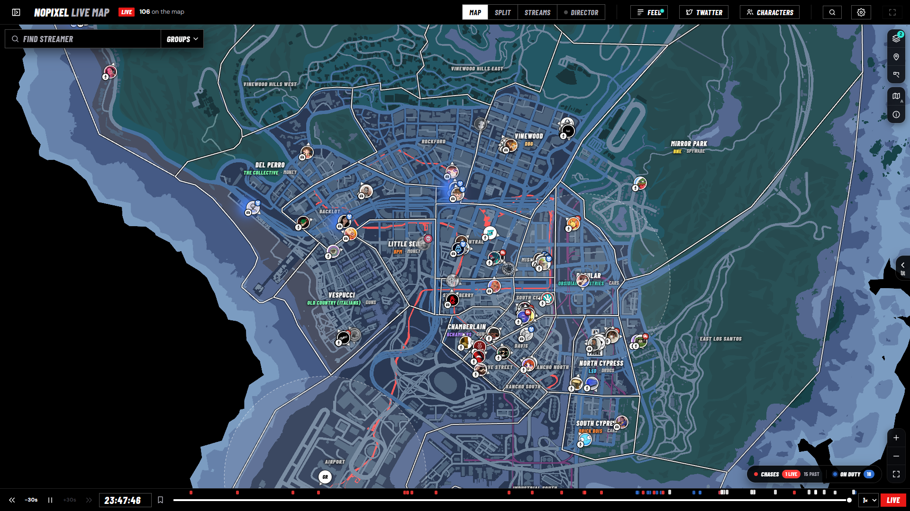
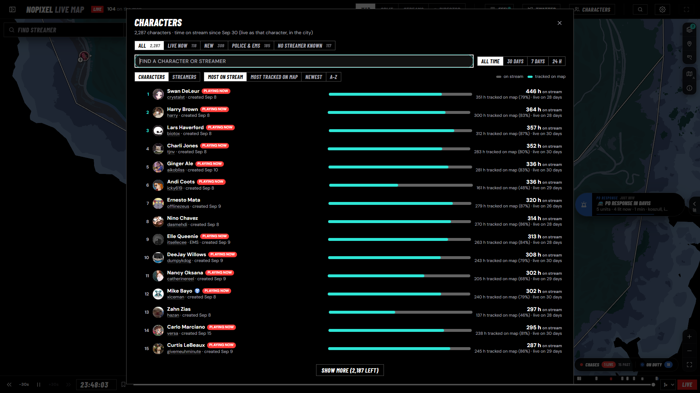
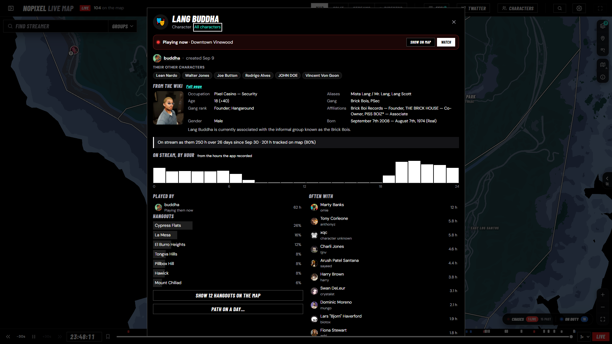
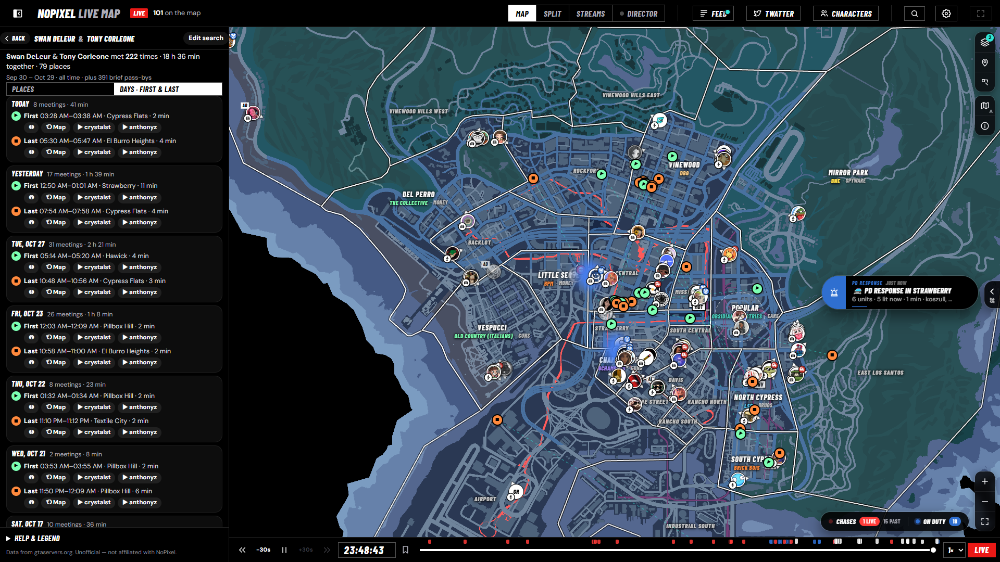
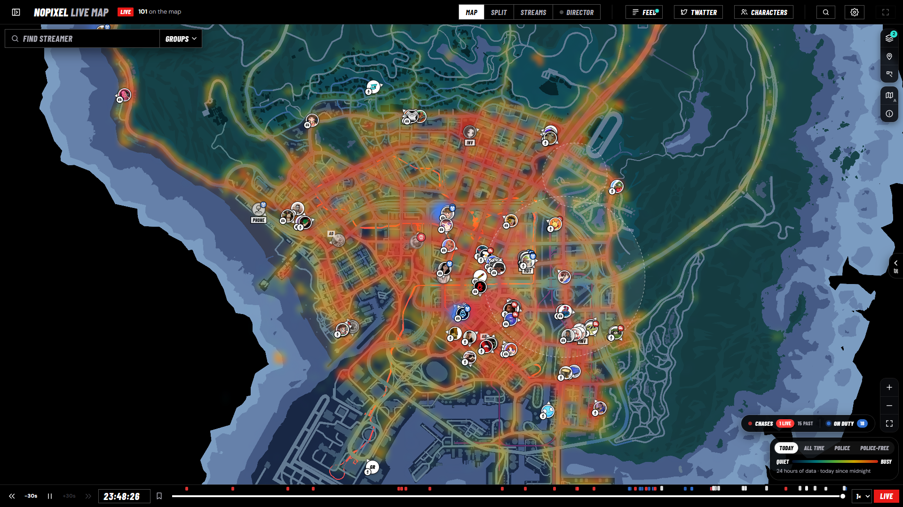

# 🗺️ NoPixel Live Map

**Every NoPixel streamer who's live, where they are in Los Santos right now, with their stream one click away, and weeks of city history behind it.**

[Features](#-features) · [Download](#-get-it) · [Shortcuts](#%EF%B8%8F-keyboard-shortcuts) · [FAQ](#-faq) · [Credits](#-credits)

> [!NOTE]
> 💛 **A huge thank you to [gtaservers.org](https://gtaservers.org/nopixel).** Their live feed, which reads every NoPixel stream's minimap and puts it on the map, is what makes this app possible. Everything here is built on top of their work. If you enjoy this, go show them some love too.

---

## ✨ What it is

A Windows desktop app built on top of the public live feed behind [gtaservers.org/nopixel](https://gtaservers.org/nopixel). That feed reads every NoPixel stream's minimap a few times a minute and turns it into a position.

This app shows those positions live on a sharp, zoomable map, with everyone's stream one click away. It also **records everything it sees**, so you can look back:

- where people went, and who was where together
- every character and who plays them
- where the police patrol, and where they never do
- how long everyone has been on stream

Everything runs **on your own PC**. There are no accounts and no servers of ours; your settings and the history stay on your machine. New versions install from inside the app.

---

## 🚀 Features

<table>
<tr>
<td width="50%" valign="top">

### 🎭 Characters
A directory of **every character, about 2,300**, and who plays each (top bar → **Characters**, or <kbd>C</kbd>).

- **Live now:** who's being played right now.
- **New:** characters NoPixel made in the last 30 days.
- **Police & EMS**, and those with **no streamer known**.
- **Time on stream** for each, and how much of it was **tracked on the map**, for all time or the last 30 days, 7 days or 24 hours.

Search by character or streamer, sort by time, newest or A–Z, or see whole streamers.

</td>
<td width="50%"></td>
</tr>
<tr>
<td width="50%"></td>
<td width="50%" valign="top">

### 🧍 Character pages
Everything about one character:

- **Playing now**, where, and whether they're **downed, in a vehicle or wanted**, with **Watch** and **Show on map**.
- Who plays them, when NoPixel created the character, and **their other characters** to jump between.
- **From the NoPixel wiki:** picture, job, gang, aliases, relatives and the start of their story.
- When they're usually on, their **hangouts**, who they're **often with**, and their chases.

</td>
</tr>
<tr>
<td width="50%" valign="top">

### 🤝 Where did they meet?
Pick two characters (or streamers) and get **every place they were together** (within ~100 m), ranked by time together.

- **Places view:** numbered pins on the map.
- **Days view:** each day's **first ▶ and last ■ meeting**.
- Every meeting has **⟲ rewind the map to then**, plus both streamers' **VODs at that exact moment**.

Open it with <kbd>M</kbd>, the **Met?** button, or from any profile.

</td>
<td width="50%"></td>
</tr>
<tr>
<td width="50%"></td>
<td width="50%" valign="top">

### 🔥 Heatmaps & hiding spots
- Where people go: **today, all time, any date range, any time of day**.
- Where the **police patrol**.
- **Police-free** areas, with a ranked list of **hiding spots** people can reach on foot and police never (or rarely) visit.

Drawn smoothly at every zoom, street by street.

</td>
</tr>
</table>

### 📺 Watch
- **Multi-stream:** many Twitch & Kick streams beside the map, side by side or on a stage, with theatre mode, per-stream volume (scroll), hover-for-sound and **middle-click to close**.
- **Director mode** (<kbd>Shift</kbd>+<kbd>D</kbd>): your streams follow what's happening (chases, downed players, crowds), up to 2, 4 or 6 at a time. Your own picks are never removed.
- **Chat:** Twitch & Kick chat with **BTTV and 7TV emotes**.
- **Twatter:** the city's social feed, live. New posts **pop up on the poster's marker**, and **Where posted** shows where they were.

### 🚓 Follow the action
- **Police & chases:** chases are **detected from movement**, even when only the cops are streaming. Follow one live or **replay** it; the **On duty** board lists police by area.
- **Feed:** police lights, downed players, crowds, chases and events as they happen, each with its VOD.
- **Areas & alerts:** draw zones and get alerts when someone enters, leaves or stays, or when favourites go live.
- **Paths:** where someone went **since going live, or on any day**, with the time, place, speed and **VOD at every point**.

### ⏪ Look back
- **Rewind** the whole city to any recorded moment, in **30-second steps** (<kbd>[</kbd> <kbd>]</kbd>), or bookmark one for later.
- **VOD links ↔ the map:** paste a Twitch or Kick VOD link with its time (<kbd>Ctrl</kbd>+<kbd>V</kbd>) and the map jumps to that moment. While rewound, any marker gives you **its VOD at exactly that moment**, even after Twitch deletes the video.
- **Who's been here:** draw any shape to see everyone who's been inside it, with every visit and VOD. Add several characters to see **when they were there together**.

### 🏴 The city
- **Turfs** in the colour of the gang holding them; **edit who holds what on the fly** (right-click a turf name).
- **Groups:** the wiki's gangs, departments and businesses, plus your own.
- **Landmarks:** 2,300 of them, with in-game and real photos. Map styles **Light**, **Dark**, **Atlas** and **Satellite**, with street and district names.

### 🧰 Handy
- **Search everything** (<kbd>Ctrl</kbd>+<kbd>K</kbd>): streamers (live or not), characters, groups, areas and actions.
- **Updates itself:** when a new version is out, an **Update** button appears in the top bar.
- **A one-minute tour** on first start (<kbd>?</kbd> to replay it).

---

## 📦 Get it

1. Download **`NoPixelMapSetup.exe`** from the [**Releases**](../../releases) page.
2. Run it and click **Install**. It installs just for you (no admin needed), adds Start menu and desktop shortcuts, and lists the app in **Settings → Apps** for uninstalling.
   > Windows SmartScreen may warn about an unknown publisher (the installer isn't code-signed). Click **More info → Run anyway**.
3. **Everything's included:** the app brings its own Node.js and Python (with numpy and Pillow), so every feature works out of the box. Nothing is installed system-wide.
4. **First start:** the app builds its history from the feed's archive, back to **Sep 30, 2026**. This takes about **20–30 minutes**; a small progress ring in the bottom-right shows how far it is. The live map works right away, and the character directory fills in within a few minutes.

Requires **Windows 10 or 11** with the **Microsoft Edge WebView2 Runtime**, which is already on most PCs. If it's missing, get the [Evergreen installer](https://developer.microsoft.com/microsoft-edge/webview2/).

**Updating:** from **1.1.1** on, the app updates itself: when a new version is out, click **Update** in the top bar (or search "Check for updates"). It downloads the new setup from this page's releases, checks it against GitHub's checksum, installs it and opens again. Your settings, areas, favourites and history are kept. Older versions: install the latest `NoPixelMapSetup.exe` by hand once.

**Uninstalling:** Settings → Apps → NoPixel Live Map → Uninstall. You choose whether to keep your settings and the recorded history.

<b>Where does it keep its data?</b>

- The app: `%LOCALAPPDATA%\Programs\NoPixelMap\` (or wherever you chose in the installer)
- Its unpacked files (server, Node.js, Python): `%LOCALAPPDATA%\NoPixelMap\app-<version>\`, replaced on updates
- Your data: `%LOCALAPPDATA%\NoPixelMap\data\`: settings, the window position, a log, and `cache\` with the recorded history, the character record (`streamer-characters.json`) and cached map pictures (a few hundred MB after a few weeks)

To start completely fresh, close the app and delete `data\cache\`.

---

## ⌨️ Keyboard shortcuts

| Key | Does |
|---|---|
| <kbd>Ctrl</kbd>+<kbd>K</kbd> | Search everything (streamers, characters, groups, areas, actions) |
| <kbd>/</kbd> | Find a streamer |
| <kbd>C</kbd> | Characters |
| <kbd>M</kbd> | Where did they meet? |
| <kbd>A</kbd> | Add a stream |
| <kbd>Shift</kbd>+<kbd>D</kbd> | Director mode |
| <kbd>[</kbd> <kbd>]</kbd> | Map time back / forward 30 seconds (with <kbd>Shift</kbd>: 5 minutes) |
| <kbd>Ctrl</kbd>+<kbd>V</kbd> | Paste a Twitch or Kick VOD link: the map goes to that moment |
| <kbd>B</kbd> | Bookmark this moment |
| <kbd>H</kbd> | Heatmap |
| <kbd>T</kbd> | Turfs |
| <kbd>D</kbd> | District names |
| <kbd>L</kbd> | Landmarks |
| <kbd>S</kbd> | Satellite map |
| <kbd>N</kbd> | Night map |
| <kbd>F</kbd> | Whole map |
| <kbd>Shift</kbd>+<kbd>T</kbd> | Theatre mode |
| <kbd>,</kbd> | Settings |
| <kbd>?</kbd> | The tour |
| <kbd>Esc</kbd> | Close / back |
| **Right-click** | More options for the spot / marker / stream under the cursor |
| **Middle-click** a stream | Close it |
| **Scroll** over a stream | Its volume |

---

## ❓ FAQ

<b>"On stream" vs "tracked on map": what's the difference?</b>

**On stream** is the time someone was live as that character while in the city. **Tracked on map** is the part of that time with a readable minimap, so an exact position. Menus, phone screens, interiors, cutscenes, the MDT, or a stream layout covering the minimap all cost "tracked on map" time.

Most streamers sit at 75–90% tracked. Features that need a place (heatmaps, who's been here, where they met, paths) use the tracked time; the Characters list shows both.

<b>Why is a marker grey?</b>

The streamer's live, but their minimap couldn't be read for a while (menu, loading, queue, hidden HUD). The marker stays where they were last seen. Point at it: the app looks at their stream picture and tells you why.

<b>Why does a streamer show "No character listed"?</b>

No source knows yet: NoPixel's own system doesn't report one, the stream title doesn't name one, and the gtaservers roster and earlier recordings don't either. As soon as one of those appears, the character shows up.

<b>Does the app need to run all the time to keep the history?</b>

No. Anything missed while it was closed is filled in from the feed's archive the next time it runs. The pill in the bottom-right shows "Filling gaps" while it does that.

<b>Does it send my data anywhere?</b>

No. It only *reads* public data: the gtaservers feed and map, the wikis, nopixellink.dev's public character list, Twitch/Kick for streams, chat, VODs and profile pictures, BTTV/7TV for emotes, and GitHub to check for a new version. Your settings, areas, favourites and turf edits stay on your PC.

---

## 🙏 Credits

- **[gtaservers.org](https://gtaservers.org/nopixel)**: the live NoPixel feed, the map and the character/group wiki. This app wouldn't exist without it.
- **[nopixellink.dev](https://nopixellink.dev)**: which streamer plays which character, and who's playing what right now
- **[NoPixel Wiki](https://nopixel.fandom.com)** (fandom): character pages (CC BY-SA)
- **[gtadb.org](https://gtadb.org)**: satellite map and landmarks (CC BY 4.0)
- **[MapLibre GL JS](https://maplibre.org)**: the map · **[hls.js](https://github.com/video-dev/hls.js)**: Kick playback
- **[BetterTTV](https://betterttv.com)** & **[7TV](https://7tv.app)**: chat emotes
- Fonts: **Barlow Condensed** & **DM Sans** (SIL Open Font License)

---

**Unofficial fan project.** Not affiliated with or endorsed by NoPixel, gtaservers.org, nopixellink.dev, Twitch, Kick, Rockstar Games or Take-Two Interactive. All streams and characters belong to their creators.

Made for the NoPixel community 💛

